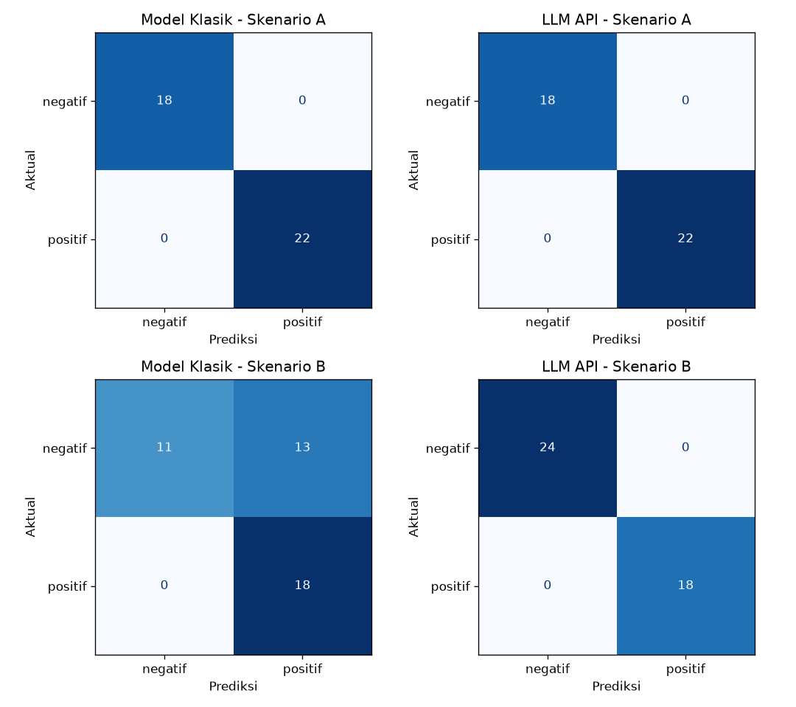

# AI Model Experiment & Evaluation: Sentiment Analysis Ulasan Pelanggan

Tugas individu AI Engineering Bootcamp (ReWork) - Abdul Latif Wicaksono

Di project ini saya membandingkan dua cara untuk menebak sentimen ulasan pelanggan e-commerce (positif atau negatif):
1. Model klasik: TF-IDF + Logistic Regression (Scikit-learn), dilatih sendiri.
2. LLM: Gemini (`gemini-3.5-flash-lite`), cukup pakai prompt tanpa training.



## 1. Problem Statement
Tim produk e-commerce mau membuat fitur yang otomatis menandai ulasan pelanggan sebagai positif atau negatif di halaman produk.
Sebelum memilih mau pakai pendekatan yang mana, saya mencoba dua pendekatan di atas, lalu membandingkan hasil, effort, kecepatan, dan biayanya.

Label yang ditebak ada di kolom `sentiment`:
- `positif`: pembeli puas.
- `negatif`: pembeli kecewa atau komplain (barang rusak, palsu, tidak sesuai, pengiriman lama, pelayanan buruk).

Batasan dan asumsi:
- Input-nya hanya `review_text`.
- Hanya ada 2 kelas, tidak ada kelas netral.
- Label di dataset saya anggap sudah benar, dan file dataset tidak diubah.
- Kedua pendekatan dites dengan test set yang sama.
- Gemini dipakai apa adanya (tanpa fine-tuning) dengan kuota API gratis.

## 2. Dataset
File: [`data/customer_reviews_sentiment.csv`](data/customer_reviews_sentiment.csv) (dataset dari mentor).

Isinya 200 ulasan dari 15 produk, dengan kolom `review_id`, `product_name`, `review_text`, dan `sentiment`. Tidak ada missing value. Labelnya 110 positif dan 90 negatif.

Waktu dicek, ternyata 200 ulasan ini cuma berisi 40 kalimat yang berbeda, karena kalimat yang sama diulang-ulang (ada yang sampai 12 kali).
Akibatnya, kalau di-split acak, 39 dari 40 ulasan di test set kalimatnya sudah ada di train set. Jadi model klasik bisa dapat nilai bagus hanya karena hafal.

## 3. Ringkasan Eksperimen
Saya pakai dua cara split:
- **Skenario A:** split 80/20 per baris seperti di starter notebook (`stratify`, `random_state=42`). Hasilnya 160 train dan 40 test.
- **Skenario B:** split per kalimat unik (32 kalimat untuk train, 8 kalimat untuk test, atau 42 baris). Di sini kalimat test benar-benar tidak ada di train,
  jadi bisa kelihatan bagaimana model menghadapi kalimat baru.

Selain itu saya buat 10 ulasan sendiri yang lebih susah (ada negasi, bahasa gaul, kalimat campuran, dan sindiran) untuk melihat kesalahan seperti apa yang dibuat masing-masing. Hasil ini tidak dimasukkan ke tabel metrik utama.

Model klasik memakai `TfidfVectorizer()` dan `LogisticRegression()` seperti di starter. Stopword tidak dihapus karena kata seperti "tidak" penting untuk sentimen.

Untuk Gemini saya pakai prompt zero-shot (tanpa contoh) yang berisi konteks ulasan e-commerce, definisi positif dan negatif, pengingat soal kata negasi, dan permintaan untuk menjawab satu kata saja.
`temperature` saya set 0 supaya jawabannya konsisten. Awalnya saya coba `gemini-2.5-flash` tapi sudah tidak tersedia (error 404), dan `gemini-3.8-flash` sering error 503 karena servernya penuh, jadi saya pakai `gemini-3.5-flash-lite`.

## 4. Hasil Evaluasi
| Pendekatan | Accuracy | Precision (macro) | Recall (macro) | F1 (macro) | Recall negatif |
|---|---|---|---|---|---|
| Model Klasik, Skenario A | 1.0000 | 1.0000 | 1.0000 | 1.0000 | 1.0000 |
| LLM API, Skenario A | 1.0000 | 1.0000 | 1.0000 | 1.0000 | 1.0000 |
| Model Klasik, Skenario B | 0.6905 | 0.7903 | 0.7292 | 0.6816 | 0.4583 |
| LLM API, Skenario B | 1.0000 | 1.0000 | 1.0000 | 1.0000 | 1.0000 |

Di uji 10 ulasan sulit, model klasik benar 5 dan Gemini benar 10.

| | Model Klasik | LLM API |
|---|---|---|
| Perlu data latih dan training | Ya (160 ulasan, kurang dari 0,1 detik) | Tidak |
| Waktu prediksi per ulasan | Kurang dari 1 ms | Rata-rata sekitar 2,5 detik (0,7 sampai 10,7 detik), sempat kena error 429 |
| Biaya per 1.000 ulasan | Gratis | Sekitar USD 0,05 |

Di skenario A keduanya dapat nilai sempurna, tapi untuk model klasik nilai ini kurang bisa dipercaya karena hampir semua kalimat test sudah ada di train.

Di skenario B model klasik turun ke accuracy 0,69, padahal train accuracy-nya tetap 1,00. Artinya model overfitting.
Recall negatifnya cuma 0,46, jadi 13 dari 24 komplain dianggap positif.
Penyebabnya, model menilai kata per kata. Contohnya kata `respon` dan `ukuran` dianggap positif karena di train hanya muncul di kalimat positif ("respon cepat", "ukuran pas").

Di uji ulasan sulit, model klasik salah di kalimat seperti "kualitas tidak murahan" dan kalimat campuran, sedangkan Gemini benar semua.

Detail lengkapnya ada di notebook dan folder `documentation/`.

## 5. Trade-off dan Limitation
Dari sisi hasil, Gemini lebih unggul, terutama untuk kalimat yang belum pernah dilihat.

Model klasik perlu data berlabel dan harus dilatih ulang kalau gaya bahasa ulasan berubah.
Gemini tidak perlu training, tapi tetap ada pekerjaannya: membuat prompt, merapikan jawaban, dan menangani error API.

Model klasik jauh lebih cepat dan jalan di komputer sendiri, sedangkan Gemini tergantung internet, server, dan kuota.
Model klasik juga gratis, sedangkan Gemini bayar per token, jadi makin banyak ulasan makin mahal.

Kekurangan model klasik: dia cuma menghafal kata, bukan memahami kalimat, jadi lemah di negasi, kalimat campuran, dan kata baru.
Data 40 kalimat juga tidak cukup untuk melatihnya.

Kekurangan Gemini: lambat, bisa kena batas kuota, modelnya bisa dihentikan oleh Google, dan isi ulasan harus dikirim ke luar.
Gemini juga belum pernah salah di sini, tapi test set-nya kecil, jadi belum tentu 100% juga di data asli (misalnya ulasan yang panjang atau netral).

## 6. Rekomendasi
Saran saya, **pakai Gemini (LLM API) dulu untuk tahap awal**, karena:
1. Hasilnya lebih bagus di ulasan baru (F1 1,00 vs 0,68).
2. Komplain pelanggan tidak ada yang lolos (recall negatif 1,00 vs 0,46).
3. Tidak perlu data latih.
4. Kekurangannya masih bisa diakali. Ulasan bisa diproses di belakang layar saat ulasan masuk lalu hasilnya disimpan, jadi lambatnya tidak terasa oleh pengguna. Biayanya juga kecil.

Ke depannya, kalau ulasan asli sudah banyak, model klasik bisa dicoba lagi supaya lebih hemat dan tidak tergantung API.

## 7. Struktur Project
```
├── data/customer_reviews_sentiment.csv        # dataset asli
├── notebook/experiment_notebook.ipynb         # notebook eksperimen + output
├── documentation/
│   ├── model_comparison_summary.png           # gambar confusion matrix
│   ├── evaluation_summary.csv                 # tabel metrik
│   ├── llm_predictions.csv                    # jawaban Gemini untuk test set A dan B
│   └── llm_predictions_uji_sulit.csv          # jawaban Gemini untuk 10 ulasan sulit
├── README.md
└── requirements.txt
```

## 8. Cara Menjalankan
```powershell
py -3.12 -m venv .venv
.venv\Scripts\activate
pip install -r requirements.txt
```
1. Buka `notebook/experiment_notebook.ipynb` di VS Code, pilih kernel `.venv`, lalu klik **Run All**.
2. Jawaban Gemini sudah tersimpan di folder `documentation/`, jadi notebook bisa dijalankan tanpa API key.
3. Kalau mau memanggil Gemini lagi:
   - Isi `GEMINI_API_KEY` di environment variable, atau buat file `.env` di root project berisi `GEMINI_API_KEY=api_key_anda`.
   - Hapus `documentation/llm_predictions*.csv`.
   - Jalankan ulang notebook.
